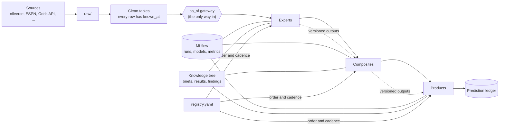

# Architecture

> How PCF's code is built: where code lives, how data is stored, how point-in-time is enforced, how experts plug together, how models and knowledge are tracked and reused, and how it all runs.
> Decided with the CEO on **2026-10-30**. The reasons behind each choice are in [`decisions/`](decisions/).
> Most of this is **planned**: it's the blueprint for the Phase 0 foundation projects. Each section names the project that builds it.

## The goals this design serves

1. **Testable and validated.** Every piece can be tested on its own, and every model can prove it has signal and doesn't leak.
2. **Strictly the past.** A prediction made at a moment may use only what was known before that moment. This is enforced by code and tests, not by care.
3. **Add an expert anywhere.** Every expert plugs in the same way, so the 30th expert is as easy as the 3rd.
4. **Never redo work.** Every finished project leaves behind outputs, a model and written knowledge that later projects can build on: a tree of context.

## The shape



## Code layout

One Python package, organized by layer (built by `package-scaffold`).

```
pcf/
  pyproject.toml, uv.lock   dependencies, pinned (uv)
  config.toml               every path and setting (rule f)
  .env                      API keys only (gitignored)
  src/pcf/
    config.py               the only place paths are resolved
    cli.py                  the `pcf` command
    core/
      log.py                logging that masks API keys
      contract.py           the Expert interface and the standard output schema
      registry.py           reads registry.yaml: dependency order, cadence rules
      tracking.py           MLflow wrapper: log runs, register models, load them
      ledger.py             the prediction ledger
    data/
      sources/              one module per source (nflverse, espn_odds, odds_api, ...)
      clean/                the cleaning functions, ported from old/ and tested
      timeline.py           the NFL calendar and every source's known-at rule
      tables/               tables at each level of detail (play, player-game, team-week, ...)
      tags/                 tag tables
      gateway.py            as_of(): the only way models read data
      schemas.py            column contracts for every table
    experts/<id>/           one folder per expert, same layout (see "The expert contract")
    composites/<id>/
    products/<id>/
    validation/             walk-forward splits, metrics, calibration, null tests, leakage tests
  tests/                    pytest, mirroring src/pcf/
  projects/<id>/            BRIEF.md, RESULTS.md, explore/ (scripts and notebooks, rule i)
  data/                     gitignored: see "Storage"
```

Folder names use underscores where project ids use dashes (`voe-live` → `experts/voe_live/`), because Python module names can't contain dashes.

## Storage

Data is **Parquet** files, read and written with **Polars**. **DuckDB** queries them with SQL when that's clearer, and its `ASOF JOIN` ("the latest value known at that moment") is built for our known-at rule. Nothing runs as a server.

| Zone (`pcf/data/…`) | What | Format | If lost |
|---|---|---|---|
| `raw/` | Source responses exactly as fetched. Dated snapshots for sources that get revised (DATA_SOURCES.md). | Parquet, or gzip JSON for APIs | Re-download. **Collected odds can't be:** they live in the private `pcf-data` repo. |
| `interim/` | Cleaned source tables, each row with `known_at` | Parquet | Rebuild |
| `tables/` | Tables at each level of detail, plus tag tables | Parquet | Rebuild |
| `features/` | Cached feature matrices | Parquet | Rebuild |
| `outputs/<id>/<version>/` | Each model version's predictions, including its walk-forward history | Parquet | Rebuild, slowly |
| `mlflow/` | The tracking database and saved models | SQLite + files | Rebuild, slowly |
| `ledger/` | Every prediction made before kickoff | Parquet, append-only | **Can't be rebuilt.** It's the live track record, so it lives in `pcf-data`, like the odds. |
| `logs/` | Run logs | Text | Fine |

**Every table follows the same contract** (`data/schemas.py`, checked on every write):
- Its key columns (e.g. `gsis_id, game_id`) and their types.
- **A `known_at` column**, in UTC and timezone-aware: the earliest moment PCF could have had this row (DATA_SOURCES.md). No row without one.
- Partitioned by season, so a refresh rewrites only what changed.

Polars is the default dataframe library. Data converts to pandas or NumPy only at the edge of a model library that needs it.

## Point-in-time: the as_of gateway

**Models never read tables directly.** They ask the gateway for a view of the world at a moment:

```python
view = gateway.as_of("2026-11-03 14:00 UTC", cadence="in_season", inputs=expert.inputs)
plays = view.table("play")        # only rows with known_at <= the moment
```

The gateway:
- returns only rows with `known_at` at or before the moment;
- for snapshotted sources, picks the latest snapshot taken at or before the moment;
- for post-season-only sources (participation), returns only seasons finished before the moment when the caller is `in_season` (rule m);
- refuses any table or expert output the caller didn't declare in `inputs`.

The gateway is built by `timeline`, `grain-tables` and `validation-harness`.

### Leakage defense in depth

No single check catches every leak, so we stack them. Each runs automatically. "Blocks" means a model that fails it can't be registered or shipped.

| # | Check | What it catches | When it runs | |
|---|---|---|---|---|
| 1 | **Gateway only** | Code that reads data around the gateway. A test fails if any expert, composite or product imports a loader or opens a data file itself. | Every test run | Blocks |
| 2 | **known_at sanity** | Missing or timezone-less `known_at`. Rows "known" before their event happened (a stat known before its game was played). | Every data refresh | Blocks |
| 3 | **Future perturbation** | Any feature that changes when data *after* the cutoff is scrambled. The features must come out identical. Run at many random cutoffs: mid-season, week boundaries, the offseason. | Every model | Blocks |
| 4 | **Future deletion** | The same, with future rows deleted instead of scrambled. Catches code that grabs "the last row" or counts rows. | Every model | Blocks |
| 5 | **Cadence (train/serve match)** | An in-season model using data that isn't available live, like participation. A model trained on a field it can't be fed live would quietly break in production. | The gateway at runtime, plus a test | Blocks |
| 6 | **Model vintage** | A feature produced by a model trained on data *after* the row it's used for. Every expert output carries its `train_end`, and every handoff checks `train_end < as_of`. | Every handoff | Blocks |
| 7 | **Walk-forward splits only** | Random cross-validation that mixes the future into training. The validation harness has only time-ordered splitters, with a gap between training and test. | Validation harness | Blocks |
| 8 | **Test-label perturbation** | Anything fit on the full dataset: feature selection, scalers, imputers, target encodings (rule k). Scramble the test fold's outcomes and refit. Test predictions must not change. | Every model | Blocks |
| 9 | **Shuffled-target null** | Features secretly built from the outcome. A model trained on shuffled outcomes must score like noise. (It's also rule k's signal test.) | Every model | Blocks |
| 10 | **Too good to be true** | A single feature that's implausibly predictive, or a backtest that beats the closing line or public benchmarks by an implausible margin. | Every validation report | Flags for review |
| 11 | **Live vs backtest gap** | Leaks every test above missed. Once predictions are in the ledger, live accuracy is compared to backtest accuracy every week. A model that's much worse live than in backtest is suspect. | Weekly | Flags for review |

**What these can't prove:** checks 1–9 prove the code respects `known_at`. They can't prove the known-at rules themselves are right (e.g. that injury reports really are final by noon the day before). That's why the rules lean late (DATA_SOURCES.md), and why check 11 exists.

## The expert contract

Every expert, composite and product implements the same small interface (`core/contract.py`, built by `package-scaffold` and `validation-harness`):

```python
class VoeLive(Expert):
    id = "voe-live"                  # matches registry.yaml
    cadence = "in_season"
    grain = "player_game"            # one output row per player per game
    inputs = ["play", "player_game", "context-live"]   # the gateway refuses anything else

    def features(self, view) -> pl.DataFrame: ...      # built from the as_of view only
    def fit(self, train_window) -> Model: ...
    def predict(self, model, view) -> pl.DataFrame: ... # in the standard output schema
    def explain(self, model) -> dict: ...               # coefficients, importances, SHAP
```

A test checks that `inputs` matches the project's `depends_on` in the registry, so the dependency graph on paper is the graph in the code.

**The standard output schema.** Every output table has the same columns, so any layer above can read any expert without custom glue:

| Column | Meaning |
|---|---|
| entity keys | the ids for its grain (`gsis_id`, `team`, `game_id`, `season`, `week`, …) |
| `as_of` | the moment the prediction was made (the data cutoff) |
| `quantity` | what's predicted, e.g. `voe_rec_yards` |
| `mean`, `q10`, `q50`, `q90` | the prediction **and its uncertainty** (rule d) |
| `model`, `model_version`, `run_id` | exactly which model made it (MLflow) |
| `train_end` | the last `known_at` in that model's training data (check 6) |
| `cadence` | in_season, retrospective or offseason_events |

**Two kinds of output per model version:**
- **The walk-forward history.** For every past week (in-season) or season (retrospective), the prediction a model trained *only on earlier data* would have made. **Higher layers train on this,** which makes their features out-of-fold by construction (rule e).
- **The live prediction.** The latest model, applied to this week. Higher layers use it for this week's predictions.

> ⚠️ **The vintage rule:** never run today's best model over past rows to make training features. A model trained through 2025 "knows" 2025, so its 2023 predictions are leaked. Reuse a model's *history output* for the past, and the model itself only for the future. Check 6 enforces this.

## Tracking and reuse: MLflow

**MLflow** records every training run, keeps every model, and marks the best one (built by `experiment-tracking`). It runs locally with no server: the database and models live in `pcf/data/mlflow/`, and `uv run mlflow ui` opens a browser view of every run.

**How runs are organized:**
- **One MLflow experiment per project** (named by its registry id).
- **One parent run per attempt**, with **one child run per rung of the ladder** (baseline → lasso → … → XGBoost). See below.
- **Each run logs:**
  - the git commit, and whether there were uncommitted changes;
  - the data snapshot and training window (`train_end`);
  - parameters and the features used;
  - metrics: backtest, calibration, the null test and every leakage check;
  - artifacts: coefficients, importances, SHAP values, calibration plots, the rung's takeaways, and where its outputs were saved.

**The model registry** (MLflow's, not our `registry.yaml`):
- Each expert gets a registered model, `pcf.<id>`, with numbered versions.
- The alias **`champion`** marks the current best. **`challenger`** marks a candidate being compared against it.
- **Only a run that passes every blocking leakage check can be registered.** The tracking wrapper refuses otherwise.
- **Training pins an exact version** (e.g. `pcf.voe-live` version 4), and the run records it, so results reproduce. **The weekly run uses `champion`**.

**Three ways a later project reuses a finished one:**
1. **Its outputs** (the usual way): read `outputs/<id>/<version>/`. The history is for training, the live prediction for this week.
2. **Its model:** load a pinned version to score new rows, or open it up (coefficients, SHAP) to see *why* it learned what it did. No retraining.
3. **Its knowledge:** cite its findings (next section).

## The knowledge tree

Every project leaves written knowledge behind, so later projects build on it instead of repeating it. The templates are in [`projects/_templates/`](../projects/_templates/).

- **Before building: `BRIEF.md`.** The question, goals, assumptions, what success and failure look like (as tests), how it will be used, and **what it builds on**: which earlier projects' findings, outputs and models it uses, and what was already tried.
- **After building: `RESULTS.md`.** What we found, the pitfalls, what could be improved, what we didn't look at, and what not to redo. Plus **the interface card**: inputs, outputs, level of detail, update interval, cadence, known-at, how to use it, and where it feeds.
- **Findings get ids.** Each finding in a RESULTS.md is numbered (F1, F2, …) and cited as `<project>#F3`. It states the claim, the evidence (an MLflow run id or a chart), how confident we are, and what it applies to.
- **The interface card is also stored in `registry.yaml`** (the `interface` block) when a project reaches done, so code and Claude can read it.
- **`projects/KNOWLEDGE.md`** is an index of every finding across projects. `registry-tooling` will generate it from the RESULTS files; until then it's kept by hand. **It's the first thing Claude reads before helping write any brief.**

So the tree is: projects (`registry.yaml`, linked by `depends_on`) → their findings (RESULTS.md) → the briefs that cite them. A project can build on four, five or six others' outputs, models and findings at once.

## The ladder: simple to complex, knowledge carried forward

Every modeling project climbs a ladder of methods (rule k). **A rung doesn't have to reuse the previous rung's outputs. It must use its takeaways.**

| Rung | Typical methods | What it teaches the next rung |
|---|---|---|
| 0. Baseline | rolling average, the market line, last season | the bar to beat |
| 1. Linear | linear or logistic regression, lasso, ridge | which features matter, their signs, collinearity |
| 2. Structured | interactions and curves from rung 1, GAMs, mixed models for small samples | whether the effects bend or interact, how much small samples shrink |
| 3. Trees | XGBoost, LightGBM | whether trees find interactions rung 2 missed (compare SHAP) |
| 4. Structure finding | PCA, clustering | for questions about types (roles, schemes) |
| 5. Distributional | quantile models, Bayesian (PyMC) | when the uncertainty itself is the product |

- Each rung is a child run in MLflow and ends with a short **takeaways** note: e.g. "lasso kept 6 of 40 features; targets and air yards are collinear; the rest-days effect looks like it depends on travel".
- **The next rung states which takeaways it applied.**
- The ladder stops when a rung doesn't beat the one below. The simpler model ships (rule k).
- Not every project needs every rung. The brief says which rungs are planned.
- At the end, the takeaways worth keeping become findings in RESULTS.md.

The bar for each check (scores, calibration, thresholds, the vault) is in [`VALIDATION.md`](VALIDATION.md).

## Running it

**The `pcf` command** (built by `package-scaffold` and `registry-tooling`):

| Command | Does |
|---|---|
| `pcf refresh` | Pull the sources and rebuild the tables that changed |
| `pcf run weekly` | Run every due project in dependency order, using `champion` models. Write outputs and the ledger. |
| `pcf run <id>` | Run one project (with `--upstream` to run what it needs first) |
| `pcf backtest <id>` | Build the walk-forward history and the validation report |
| `pcf check` | Validate the registry, schemas and leakage suite |
| `pcf status` | Project statuses and the impact map |

**`registry.yaml` is the pipeline.** `depends_on` gives the order (no separate pipeline file to keep in sync), and `cadence` says what's due: in-season projects weekly, retrospective after the season, offseason-events when those events land.

**Where things run:**

| What | Where | Why |
|---|---|---|
| Odds collectors | GitHub Actions (live) | Must run on time even when the PC is off. Small. The data can't be re-downloaded, so it's pushed to `pcf-data`. |
| Refresh, modeling, reports | The CEO's PC, via **Windows Task Scheduler** | Needs the local data and MLflow. Heavy. Keeps outputs private, since Actions logs on this repo are public. |

The first schedule (US Eastern, refined in `weekly-run`):
- **Tuesday morning:** the full weekly run, since Monday night's data is in by then.
- **Wednesday afternoon:** an update with Thursday's final injury report.
- **Saturday afternoon:** an update with Sunday's final injury reports.

The tasks are set to wake the PC and to run as soon as possible after a missed start. Logs go to `pcf/data/logs/`.

## Tooling

| Piece | Choice |
|---|---|
| Language | **Python only** (3.12, matching Actions). R in `old/` stays reference. |
| Environment | **uv**, `pyproject.toml` and a lockfile, so every run uses the same library versions |
| Data | Polars, DuckDB, Parquet |
| Models | scikit-learn, statsmodels, XGBoost/LightGBM, PyMC when needed |
| Tracking | MLflow (local) |
| Tests | pytest: cleaning functions, schemas, the leakage suite, the contract |
| Table checks | pandera (it supports Polars) |
| Lint and format | ruff (details in `CONVENTIONS.md`, to be written) |
| Config | `pcf/config.toml` for paths and settings, `pcf/.env` for keys (rule f). The odds scripts' temporary `PCF_DATA_DIR` variable moves into config. |

**Guardrail for Claude:** once the scaffold exists, `.claude/settings.json` will deny Claude's file-editing tools inside `old/`, so rule a is enforced and not just written down.

## Assumptions and limitations

- **The PC must be on** (or wakeable) for weekly runs. If it's off, the run happens when it's next on. The collectors don't depend on it.
- **MLflow and `outputs/` live on one PC with no backup.** They can be rebuilt from code and data, but slowly. A backup is a decision in the roadmap's queue.
- **Size:** play-by-play since 1999 plus features is a few GB at most. Polars and DuckDB handle that without loading everything at once. Big Data Bowl tracking stays in separate case studies.
- **Leakage tests cost compute** (refitting at many cutoffs). They run on sampled cutoffs, and results are cached per model version.
- **The checks can't prove the known-at rules are right.** See "What these can't prove" above.
- **The odds scripts** in `projects/odds-collection/explore/` move into `data/sources/` during that project's build.

## Decisions

- [0001: Python only](decisions/0001-python-only.md)
- [0002: Parquet, Polars and DuckDB](decisions/0002-storage.md)
- [0003: The as_of gateway and stacked leakage checks](decisions/0003-as-of-gateway.md)
- [0004: MLflow for tracking and model reuse](decisions/0004-mlflow.md)
- [0005: Collectors on Actions, modeling on the PC](decisions/0005-where-it-runs.md)
- [0006: A rolling vault season and proper scores](decisions/0006-validation-vault.md)
